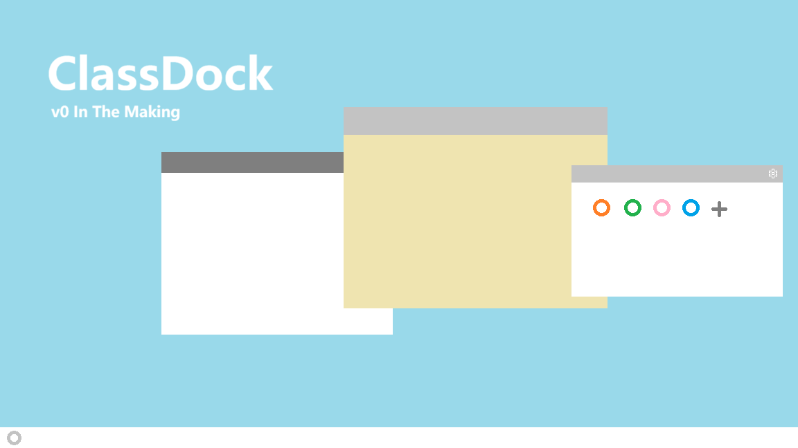

# ClassDock

ClassDock 是一个面向教学场景的桌面侧边栏工具集，致力于将常用教学工具整合到同一入口。它强调易用性、便捷性与自由，希望帮助教师在不打断课堂节奏的前提下，更轻松地使用教学中的常用功能，从而优化教学体验环境。



## 当下

- [x] 做出面板
- [x] 做出"关于"页
- [x] 一个潦草的封面

## 功能

### 基本功能

- [ ] 屏幕批注
- [ ] 截屏
- [ ] 计时器/倒计时

### 联动类功能

- [ ] 其他教室类应用功能调用(IPC/URL)
- [ ] 快捷方式
- [x] ∞无限可能

## 技术架构

ClassDock 基于 **WinUI 3 (Windows App SDK)** 构建：

- 使用 **C# + WinUI 3 XAML**，Fluent 2 浅色设计语言；
- 非打包模式（Unpackaged）+ WinAppSDK 自包含发布，无需安装额外运行时；
- 通过原生 Win32 / DWM 互操作实现无边框透明覆盖、全局置顶、窗口最小尺寸解除等功能；
- 后续屏幕批注将基于"整个屏幕作为可穿透画布"的设计思想实现。

## AI 创作声明

本项目的代码与界面主要由 **AI（Trae Agent）** 生成与迭代，由项目作者提出需求、审核并整合。

## 运行环境要求

### Windows

- **操作系统**：Windows 10 版本 1809（10.0.17763）及以上，或 Windows 11
- **运行时**：.NET Desktop Runtime 8.0 及以上（自包含发布则无需安装）
- **推荐环境**：双核 CPU、8GB 内存、500MB 以上可用磁盘空间

### Linux

- **操作系统**：Ubuntu 22.04 及以上
- **依赖组件**：`libfontconfig1` 及相关托盘、网络依赖
- **推荐环境**：双核 CPU、8GB 内存、500MB 以上可用磁盘空间

## 构建与运行

### 构建前准备

- **.NET SDK**：8.0 及以上（`dotnet --version` 可验证）
- **工作负载**：无需单独安装，WinUI 3 与 Windows App SDK 通过 NuGet 包还原
- **平台**：仅支持 Windows x64（项目已固定 `win-x64`）

<br />

### 构建

在项目目录（`ClassDock.csproj` 所在目录）执行：

```powershell
# Debug 构建
dotnet build

# Release 构建
dotnet build -c Release
```

### 运行

```powershell
# 直接运行
dotnet run

# 运行构建产物
# Release
.\bin\Release\net8.0-windows10.0.19041.0\win-x64\ClassDock.exe
# Debug
.\bin\Debug\net8.0-windows10.0.19041.0\win-x64\ClassDock.exe
```

### 常见问题

- **构建报 MSB3027（文件被占用）**：ClassDock.exe 正在运行，先结束进程再构建：
  ```powershell
  Stop-Process -Name ClassDock
  ```
- **启动后看不到白条**：确认没有其他置顶窗口遮挡屏幕右缘，并检查分辨率缩放（白条按 DPI 自适应，支持 Per-Monitor V2）。

## 项目进度

- [x] 新建文件夹
- [x] 创建Readme.md
- [x] 明确实现方案
- [x] 完成可用测试版本
- [x] 做出“屏幕批注”功能的界面
- [x] 完成绘图(目前仅支持红色)与橡皮擦(笔画擦除)
- [x] 修好界面
- [ ] 画笔选择颜色与调节粗细功能
- [ ] 其他类型的笔
- [ ] 面积橡皮擦与全屏清空
- [ ] 几何绘图(矩形,直线/向量,园,坐标系)
- [ ] 其他批注小工具(屏幕标尺,导出至本地)

## 版本

- [x] v0 **In the Making**
- [ ] v1 **Amphoreus**

## 贡献

### 提交 Issue

提交 Issue 前，建议先搜索是否已有类似问题。如果是 Bug 反馈，请尽量提供：

- 操作系统版本；
- ClassDock 版本号；
- 复现步骤；
- 预期行为与实际行为；
- 相关截图或日志。

如果是功能建议，可以说明使用场景、期望效果，以及是否会影响现有功能。

### 代码贡献流程

> \[Tips] 此处还没想好怎么弄

### 开发准备

如果你希望参与开发，需要安装以下环境：

- .NET SDK
- 对应平台的系统依赖

## 许可证

ClassDock 基于 GPL-3.0 开源，详见 [LICENSE](./LICENSE)。
